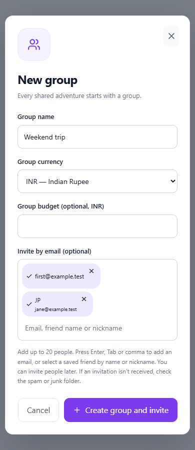
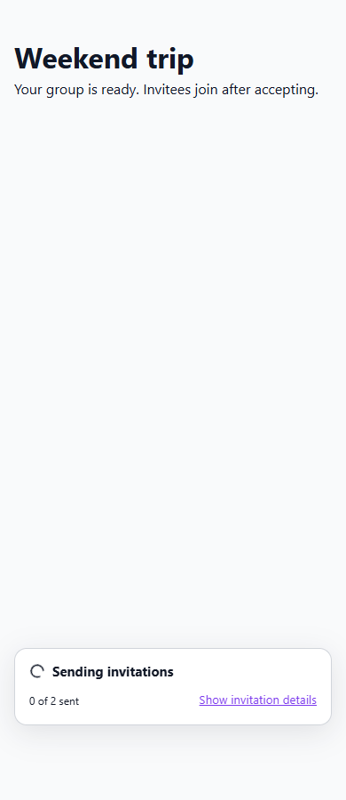

# Expense invitation validation and background sending

Issues: [#34](https://github.com/Tripraft/Tripraft/issues/34), [#35](https://github.com/Tripraft/Tripraft/issues/35).

The optional new-group invitation field accepts up to 20 unique recipients.
Enter, Tab, comma and pasted address lists create removable email chips. Saved
friends resolve by name, private nickname or email; their chips show the name
and underlying address. Invalid entries block group creation and remain editable.

After creation, the dialog closes and the selected group opens immediately.
Invitations send in the background, with at most three requests in flight. A
small status card in the bottom corner animates while sending; it does not lock
the page, cover the screen or take focus. Users can explore the group and open
delivery details when needed. Reduced-motion preferences disable the animation.

The card distinguishes queued, sent, failed and unavailable email. It checks
persisted queue results every 1.5 seconds for up to 30 seconds and offers a manual
status check. Checking status does not resend mail. Retry acts only on failed
recipients and reuses saved invitation IDs. Persisted results are also available
in Members after the page is reloaded.

## Recipient visibility

New queued, failed or disabled invitations are visible to their sender/group,
and are absent from the recipient's pending invitation list and live invitation
updates. Successful SMTP acceptance sets `email_sent_at` once per invitation
generation and publishes that invitation to the recipient. Resends preserve this
marker, reuse the same row/link and do not create another recipient notification.
A failed later resend does not revoke an invitation already sent successfully.
Cancellation, expiry and re-invitation still use the existing lifecycle checks;
stale worker results cannot publish a reissued invitation.

Email status records mail-server acceptance, not inbox delivery. The current
SMTP integration does not receive later bounce or mailbox-delivery events.
Address validation checks email syntax; it does not verify mailbox ownership.
An invitation creates no membership until the recipient accepts. Explicitly
shared invitation links remain usable under the existing account checks.

## Migration and rollout

Apply `d39fe8091a23` after `c28ed7f80912` before deploying the API. It adds nullable
`invitations.email_status` and `invitations.email_sent_at` columns. The matching
development manifest supports the restricted startup migration process.

Existing delivery history is unknown, so the migration leaves both fields null.
Legacy pending invitations remain in the sender's group; a successful retry is
required before they appear in the recipient's invitation inbox. Existing group
memberships and invitation links remain intact. Rolling back requires first
reverting the API/worker code, then downgrading the migration; downgrade removes
only the two delivery tracking columns. Follow the normal database release
approval process in [database-releases.md](database-releases.md).

## Validation

- 119 backend tests: send failure/exception, native and Celery stale jobs,
  cancellation, repeat sends, authorization, real-time isolation, group
  lifecycle, contacts, read latency and migration/schema parity.
- 17 database release tests: additive manifest planning and release controls.
- 73 frontend tests: chips, saved friends, validation, immediate group navigation,
  bounded sending, retries, queue results and expense notifications.
- Real Chromium layout/interaction checks at 1100px, 390px and 320px: compact
  background indicator, immediate group page, chip deduplication, name lookup,
  no dialog overflow, animation and reduced motion.
- Web lint, TypeScript, production build, Python lint and repository structure.

The browser check uses mocked contacts and delivery promises and sends no email:

```powershell
# Point PLAYWRIGHT_MODULE to an existing Playwright installation if needed.
node apps/web/tests/expenseInvitationFlow.mjs
```

Screenshots from the browser fixture:




