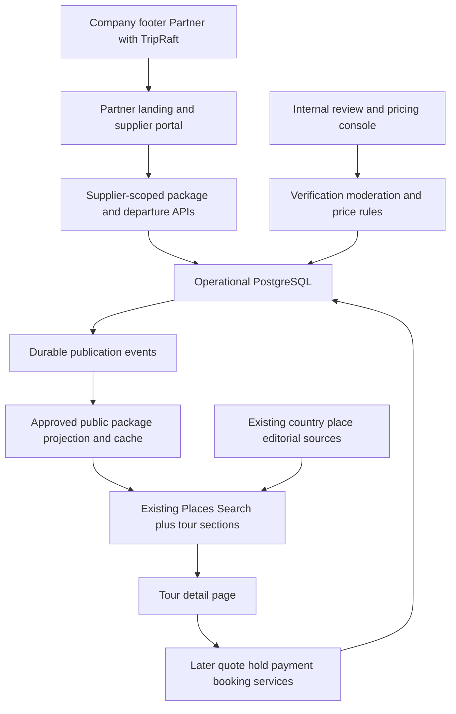

# Tour package architecture and file structure

All paths marked new are proposed implementation files. Create them when their phase begins; do not scaffold unrelated platform features. Existing files listed below retain their existing responsibilities. The public feature stays inside Places Search in the current React app.

## System boundaries



The catalog branch continues to feed its existing discovery modules. The tour branch feeds new package components from reviewed supplier records. A country/place reference can help locate a tour but never establishes its inventory or price. Search failure in one branch must not erase successful results from the other.

## Proposed source map

```text
apps/web/src/
  App.jsx                                      extend existing route composition
  components/layout/jsx/Footer.jsx             add Company → Partner with TripRaft
  features/discover/
    jsx/PlaceSearchPage.jsx                     extend with independent tour sections
    jsx/SearchBar.jsx                          optional Tours type/tab; preserve place behavior
    jsx/PlaceGrid.jsx                           existing place results
    jsx/GroupedPlaceGrid.jsx                    existing grouped place results
    jsx/PlaceDetailModal.jsx                    existing place details
    tours/                                     new: public package integration
      TourPackagesSection.tsx
      TourPackageCard.tsx
      FeaturedTours.tsx
      TourFilters.tsx
      AvailabilityLabel.tsx
      PublicTourPrice.tsx
      useTourPackages.ts
      tourPackagesApi.ts
      tourQueryKeys.ts
      __tests__/
        placesSearchTours.test.tsx
        tourPackageCard.test.tsx
        priceVisibility.test.tsx
  features/tours/                               new: package details and later buyer flow
    TourDetailPage.tsx
    TourGallery.tsx
    TourItinerary.tsx
    DeparturePicker.tsx
    TourPolicies.tsx
    TourInquiryForm.tsx
    TourCheckoutPage.tsx                        later booking phase
    TourBookingPage.tsx                         later booking phase
    tourBookingApi.ts
  features/partners/                            new: separate supplier portal surface
    PartnerLandingPage.tsx
    PartnerRegisterPage.tsx
    PartnerLoginPage.tsx
    PartnerOnboardingPage.tsx
    PartnerStatusPage.tsx
    PartnerDashboardPage.tsx
    PartnerLayout.tsx
    PartnerRoute.tsx
    partnerApi.ts
    partnerQueryKeys.ts
    packages/
      PartnerPackagesPage.tsx
      PackageWizard.tsx
      PackagePreview.tsx
      PackageRevisionStatus.tsx
      steps/
        BasicsStep.tsx
        RouteStep.tsx
        ItineraryStep.tsx
        ServicesStep.tsx
        MediaPoliciesStep.tsx
        DeparturesRatesStep.tsx
        ReviewSubmitStep.tsx
    departures/
      DepartureCalendar.tsx
      InventoryEditor.tsx
    operations/                                later booking/settlement phases
      PartnerBookingsPage.tsx
      PartnerManifestPage.tsx
      PartnerPayoutsPage.tsx
    __tests__/
      partnerAccess.test.tsx
      packageWizard.test.tsx
      revisionUpdates.test.tsx
  context/AuthContext.jsx                       extend realm/capability handling carefully
  lib/tourMoney.ts                              exact amount formatting; no authoritative totals

apps/admin/src/
  App.tsx                                      extend existing internal console
  features/partners/
    PartnerReviewPage.tsx
    PartnerVerificationDetail.tsx
  features/tour-packages/
    PackageReviewPage.tsx
    PackageDiffView.tsx
    PublicationQueuePage.tsx
    FeaturedPackagesPage.tsx
    TourPricingPage.tsx
  features/tour-operations/                     later money/operations phases
    BookingExceptionsPage.tsx
    RefundReviewPage.tsx
    PayoutReviewPage.tsx
    ReconciliationPage.tsx
    PublicationAuditPage.tsx

services/api/app/
  auth/                                        extend existing users/sessions, not a second password DB
    security/portal_access.py                  new realm/capability checks
  partners/                                    new: applicants, approved business and staff
    __init__.py
    models.py
    schemas.py
    permissions.py
    routes.py
    services/
      application_service.py
      verification_service.py
      partner_staff_service.py
  tours/                                       new: package content and public discovery
    __init__.py
    models.py
    schemas.py                                 separate partner/admin/public DTOs
    routes/
      __init__.py
      partner_packages.py
      public_tours.py
      admin_reviews.py
    services/
      package_service.py
      revision_service.py
      media_service.py
      change_classifier.py
      moderation_service.py
      publication_service.py
      public_projection_service.py
      tour_search_service.py
      merchandising_service.py
  tour_inventory/                              new: departures and authoritative capacity
    __init__.py
    models.py
    schemas.py
    routes.py
    services/
      departure_service.py
      inventory_service.py
      hold_service.py
      supplier_confirmation_service.py
  tour_pricing/                                new: private commercial logic
    __init__.py
    models.py
    schemas.py
    routes.py
    services/
      agreement_service.py
      retail_price_service.py
      tax_service.py
      quote_service.py
      price_visibility_service.py
  tour_bookings/                               later booking phase
    __init__.py
    models.py
    schemas.py
    routes.py
    state_machine.py
    services/
      booking_service.py
      cancellation_service.py
      voucher_service.py
  tour_payments/                               later booking phase
    __init__.py
    models.py
    routes.py
    services/
      order_service.py
      webhook_service.py
      refund_service.py
    providers/
      base.py
      fake.py
      selected_provider.py                     name after commercial selection
  tour_finance/                                later settlement phase
    __init__.py
    models.py
    routes.py
    services/
      journal_service.py
      invoice_service.py
      payable_service.py
      payout_service.py
      reconciliation_service.py
  core/
    factory.py                                 register new required blueprints
    config.py                                  validate tour release/policy settings
    db/connection.py                           include new model imports
    security.py                                exact signed-webhook exception later
    storage.py                                 staged uploads/private documents/public approved media
    events/                                    new durable outbox and consumer receipts
      __init__.py
      models.py
      outbox.py
      dispatcher.py
    workers/
      celery_app.py                            discover new tasks
      schedules.py                             freshness/retry/expiry/reconciliation jobs
      tasks/
        tour_publication_tasks.py
        tour_inventory_tasks.py
        tour_payment_tasks.py
        tour_finance_tasks.py

services/api/
  migrations/env.py                            import all new models into shared Base
  migrations/versions/
    <revision>_partner_access_and_applications.py
    <revision>_tour_content_and_publication.py
    <revision>_tour_departures_and_prices.py
    <revision>_tour_quotes_holds_and_bookings.py
    <revision>_tour_payment_and_financial_events.py
  contracts/tours/                             explicit operation schemas and examples
    public.json
    partner.json
    moderation.json
    checkout.json
  tests/tours/
    test_partner_access.py
    test_package_validation.py
    test_publication_policy.py
    test_public_field_allowlist.py
    test_price_visibility.py
    test_search_projection.py
    test_inventory_and_quotes.py
    test_payments_and_refunds.py
  tests/postgres/                              explicit isolated PG mode before app imports
    test_tour_migrations.py
    test_publication_races.py
    test_last_seat.py
    test_capture_expiry.py
    test_idempotency.py

packages/api-client/src/generated/schema.d.ts  regenerate after explicit contract export
packages/types/src/tours.ts                     new shared request/public types
packages/types/src/partners.ts                  new scoped portal types
infra/github/workflows/ci.yml                   canonical CI; add targeted suites
infra/docker/docker-compose.yml                add required worker/scheduler when enabled
docs/plans/places-search-tour-packages/         active planning package
```

Use the current shared `Base`, UUIDv7 helpers, cookie authentication primitives and Alembic chain. Operational PostgreSQL holds tour/partner records; the reference catalog stays separate. Redis caches and transports jobs; it is not the durable source of approvals, payments or seats. Do not introduce global company workspaces or rewrite the trip/expense aggregate for this feature.

## Route map and footer placement

| Route | Surface | Access |
| --- | --- | --- |
| `/partners` | Public landing explaining listing steps, requirements, FAQs and partner terms | Everyone |
| `/partners/register` | Partner account creation/contact verification | New applicants |
| `/partners/login` | Partner sign-in/recovery | Partner realm |
| `/partners/onboarding` | Own business application and evidence | Authenticated applicant |
| `/partners/status` | Review status, requested corrections and appeal/contact | Own applicant |
| `/partners/dashboard` | Packages, departures, updates and later bookings/payouts | Approved partner staff |
| `/partners/packages/new` | Seven-step package wizard | Approved partner content role |
| `/partners/packages/:id` | Own draft, revisions, review and published preview | Owning partner staff |
| `/places`, `/place-search` | Existing search plus featured/available package sections | Existing access unchanged |
| `/tours/:slug` | Approved tour detail | Public approved projection |
| `/tours/checkout/:bookingId` | Later authorized quote/payment | Payer/buyer, booking feature enabled |
| `/bookings/:bookingId` | Later buyer status/documents | Authorized buyer, not an enumerable public reference |
| Admin app `/partners`, `/packages`, `/tour-pricing`, `/tour-operations/*` | Internal review and operations | Relevant platform role |

The first implementation checkpoint adds a third Company list item in `Footer.jsx` after About Us and Contact: `<Link to="/partners">Partner with TripRaft</Link>`, together with the working landing and onboarding route. The normal header retains its current navigation. Other folders and route capabilities in this architecture remain proposed unless listed in the [implementation report](../../reports/partners-onboarding-foundation-2026-10-18.md).

## Supplier-only account boundary

The existing `ProtectedRoute` is only an authentication gate and even describes one login as granting all services. It cannot be reused as the complete partner security policy. Existing backend `require_auth` also needs an explicit portal permission decision for partner sessions.

Reuse the current user/password/session infrastructure, adding server-controlled portal grants and a session/token audience. New supplier-only identities receive the partner grant, not an automatic traveler grant. Partner login/refresh issues partner-scoped sessions; generic login must not convert a supplier-only identity into a full traveler session. Client-supplied role/audience fields cannot grant access.

Apply an audience/capability guard before protected domain operations. A partner-only session must fail when calling unrelated trip, expense, AI, export or private realtime APIs directly, not just when navigating their pages. Existing traveler sessions keep their behavior; adding partner membership to an existing traveler requires an explicit account-linking policy rather than silent privilege expansion. Public read routes retain their declared anonymous behavior.

Supplier membership records define owner/content/operations/finance roles, revocation and business scope. Every query validates the actor's supplier membership, not a request body's `agent_id`. Finance/admin powers are separate. Test login, refresh, role revocation, uploads, exports, worker tasks and websocket rooms against this boundary.

## Search composition and UI states

Keep existing place search requests, cancellation behavior, grouped results, modal and filters. Introduce a separate tour hook/API with query keys containing content type and tour-specific filters. Do not send tour cards into `PlaceGrid` or overload an integer place ID with a package UUID.

Blank search can show featured tours; a Tours section/tab uses its own cursor, filters, retry and zero-result state. Preserve query, tab and scroll through URL state/back navigation. An offline tours API shows a local tour error while place results remain usable. A place API failure does not erase approved tours. Do not fall back to fake packages derived from catalog rows.

Source-defined countries/trending rails must be matched to the deployed branch before editing their layout. Use approved editorial selections or measured trending data; no invented popularity badges. New tour ranking uses package relevance, publication eligibility and verified operational facts, independent of catalog `rank_score`.

## Contracts and release tooling

Add explicit new JSON operation schemas to `infra/tools/export_openapi.py`, then regenerate `packages/api-client`. The current exporter bootstraps disposable SQLite; update it deliberately if new PostgreSQL-only schema features require a PG export job. Do not export against private application data.

Expand web TS configuration to include new feature files and add the TypeScript Babel/test preset where needed. Isolate PostgreSQL tests from the current conftest's unconditional SQLite URL assignment. Add model imports in both startup and migration registries. Deploy a scheduler as well as a worker when automated jobs are enabled; a schedule dictionary does not run itself. Edit canonical workflows under `infra/github/workflows` and synchronize `.github/workflows` discovery copies.
