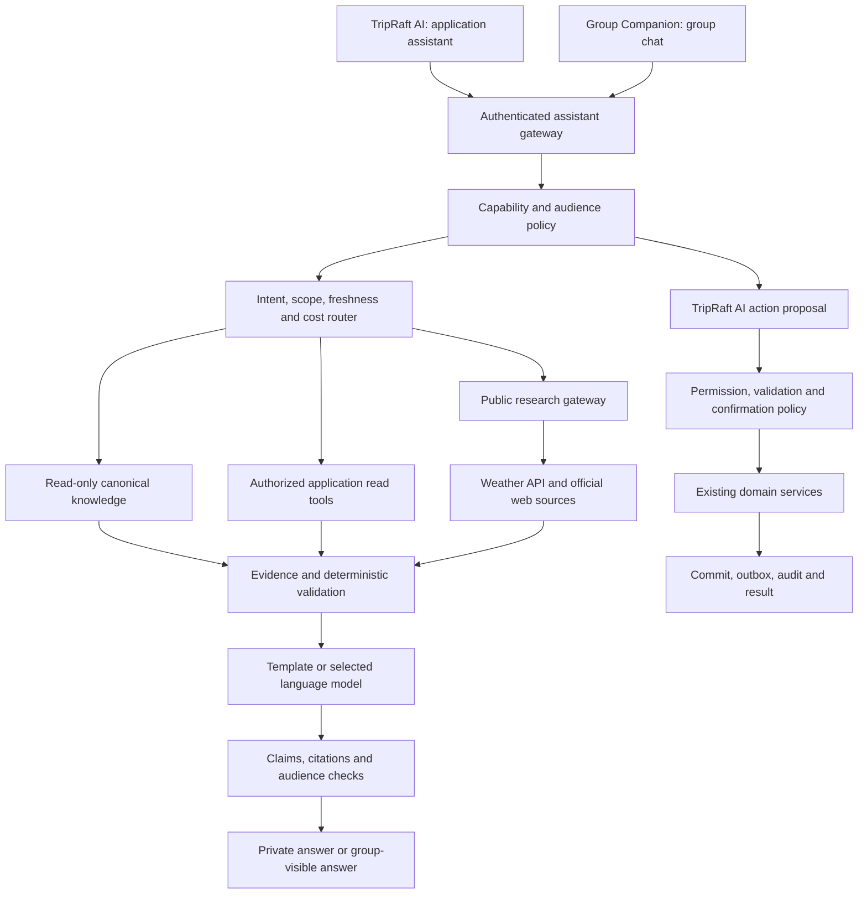

# TripRaft AI product and delivery plan

Status: proposed architecture; no runtime implementation or deployment is included in this change. Prepared 2026-10-30 from repository source, read-only local catalog inspection, and linked provider documentation. Timings, budgets, and quality thresholds below are design targets unless explicitly identified as observations.

## Product decision: two assistants

Build **TripRaft AI**, the complete assistant available across the traveler application, and **Group Companion**, the assistant that participates only inside a selected group's chat. They share infrastructure and travel knowledge. They have separate capability sets, conversation storage, audiences, and authorization contexts.

The current working interpretation of “one for chats only for group” is a read-only Group Companion. It can answer questions and discuss suggestions, but it cannot change a group, itinerary, expense, poll, or checklist. A user can open a suggestion in TripRaft AI to perform an action. If group actions are wanted later, enable individual capabilities through the same authorization and action pipeline; do not silently grant the full assistant's powers.

| Capability | TripRaft AI | Group Companion |
|---|---|---|
| Entry points | Global assistant, discovery, trip workspace, expenses | Group chat only; explicit mention/reply or opted-in trigger |
| Public travel questions | Places, weather, entry requirements, travel logistics, destination information | Same public knowledge, using the selected group as context |
| Read app data | Request-relevant records the current user may access | Group-visible records in the selected group only |
| Personal expenses and preferences | Own authorized records, private response | No access, including the requester's personal ledger |
| Other groups | Only on a user request and with independent access checks | No access, including other groups the requester belongs to |
| Plan days and suggest changes | Draft, validate, explain, and apply authorized changes | Discuss a draft; offer a handoff to TripRaft AI |
| Create/edit/delete groups or expenses | Through registered domain tools and action policy | Disabled at tool registration and execution layers |
| Group history | Bounded, relevant, consented excerpts when explicitly requested | Bounded, relevant, consented history from this group |
| Delivery audience | Private by default; explicit group publication | All current group members; private consent prompts separately |

“All tasks” means supported traveler workflows across TripRaft. It does not grant staff-console access, schema administration, arbitrary SQL, arbitrary internet automation, actual money transfer, ticket purchases, or autonomous visa applications. Each new product task needs a registered, tested capability. Travel-related emergencies receive concise assistance within scope rather than a generic off-topic rejection.

## Recommended architecture

Use one policy-controlled orchestration service in the existing Flask API. Keep SQL lookups, authorization, money calculation, itinerary validation, and action execution deterministic. Use language models for language understanding, evidence-based explanation, and difficult planning. Start with the existing SQLite canonical catalog, PostgreSQL application data in production, Redis, Celery, and existing realtime infrastructure.

The public research gateway receives a minimal travel query, never group conversations, expense descriptions, identities, or personal documents. Group Companion has no route to the action executor. Retrieved pages are evidence, never operational instructions.

## What exists today

| Foundation | Repository evidence | Design consequence |
|---|---|---|
| Scout answers and Crew commands | `services/api/app/scout/services/scout_agent_service.py`, `crew_agent_service.py` | Migrate behind the two new product entry points; retain compatibility adapters for existing mentions. |
| Local models and web search | `scout/llm/ollama_client.py`, `places/search/web_search.py` | Introduce provider adapters; model selection and retrieval must obey policy. |
| AI consent, preferences, logs, revocation | `scout/models.py`, `scout/services/consent_gate.py`, `scout/routes/ai_consent.py` | Extend purpose/audience scopes; migrate consent explicitly. |
| Domain authorization and money rules | `expenses/services/group_access.py`, `expense_service.py`, trip/itinerary services | Reuse business rules; do not duplicate calculations in prompts. |
| Confirmation cards | `scout/routes/ai_confirm.py` | Existing single-use Redis deletion confirmations are a starting point; add durable action records and conflict checks. |
| Multiple catalog paths | `core/config.py`, `places/services/planner_catalog_service.py` | General discovery defaults to `tripraft-canonical.db`; Group Planner defaults to `tripraft_places.db`. Unify through an adapter and verified identity mapping. |
| Group/private message filtering | `trips/services/chat_service.py`, Crew cards and workers | Preserve server filtering; audit realtime delivery separately before adding new private output types. |

Observed behavior to change: some place/complex answer paths fall back to model memory; weather uses web snippets; visa origin can be inferred from phone/currency; answer caching uses a general one-hour lifetime. These are unsuitable foundations for verified, current answers. Current code is not being certified by this proposal.

## Local catalog observations

Read-only inspection of `data/catalog/tripraft-canonical.db` on 2026-10-30 found:

| Measure | Observed count |
|---|---:|
| Countries / cities / places | 191 / 6,478 / 30,339 |
| Place status: verified / partial / unverified / needs review | 6,460 / 23,704 / 52 / 123 |
| Places with both coordinate fields present | 23,007 |
| Places with nonblank official websites | 4,867 |
| Data sources / field verification rows | 64,094 / 533,914 |
| Legacy opening-hours rows | 4,807 |
| Normalized hours / ticket prices / opening exceptions | 0 / 0 / 0 |
| Full-text indexed place rows / embedding rows | 30,339 / 0 |

Counts describe this machine's snapshot, not deployed coverage. Coordinate presence does not prove coordinate accuracy. Source count does not prove claim support. Legacy hours row count is not distinct-place coverage. A place's overall status cannot substitute for field-level evidence.

## Decisions that control quality and cost

1. Two assistant profiles, one reusable backend, no multi-agent debate on ordinary requests.
2. Canonical retrieval first for stable place facts; freshness requirements can force an external check even when a record exists.
3. Dedicated APIs for structured live information. Official authorities for entry rules. No unsupported “current” facts from model memory.
4. Answer using no model where a template is sufficient. One small-model call for most language work; one bounded escalation for difficult cases.
5. Read only the data needed for the request. Separate authorization, purpose permission, and publication audience.
6. Validate a concrete change before executing. Require confirmation for destructive or consequential changes; direct explicit low-risk commands can execute once.
7. Ship and measure correctness, privacy isolation, task success, latency, and total cost together. “World best” is a product ambition, not a measurable launch claim.

## Detailed specifications

| Document | Contents |
|---|---|
| [Architecture and data](architecture-and-data.md) | Boundaries, routing, catalog unification, caching, runtime flow |
| [Knowledge and citations](knowledge-and-citations.md) | Evidence contracts, live weather, visas, web research, missing information |
| [Planning and actions](planning-and-actions.md) | Day planning, edits, expense/group workflows, safe execution |
| [Privacy and security](privacy-and-security.md) | Two-assistant isolation, consent, audiences, retention, threats |
| [API and storage](api-and-storage.md) | Proposed endpoints, events, structured contracts, schema changes |
| [Cost and performance](cost-and-performance.md) | Model candidates, worked cost estimates, latency budgets, spend controls |
| [Production infrastructure](production-infrastructure.md) | Deployment topology, queues, capacity, monitoring, recovery and scaling triggers |
| [Delivery and evaluation](delivery-and-evaluation.md) | Repository file map, phases, acceptance tests, rollout and operations |

Build the policy and evidence foundations first, then TripRaft AI read-only answers, then Group Companion, then validated planning, then actions. Follow the existing [database release process](../../operations/database-releases.md) for schema changes. This proposal does not authorize a production release.
