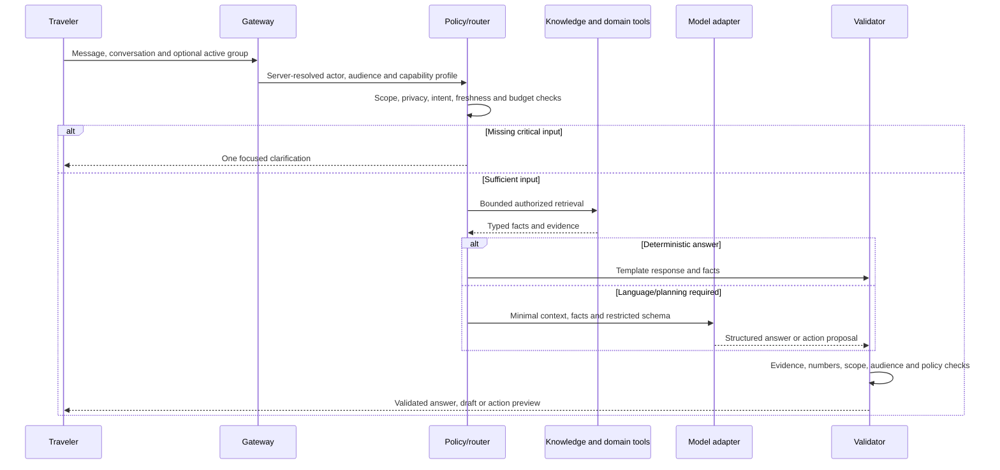

# Architecture and data flow

Status: proposed. [Plan index](README.md).

## Two assistant profiles

Define immutable server-owned profiles: `app_assistant` and `group_companion`. The selected route determines the profile; a prompt, model tool call, browser flag, or handoff payload cannot widen it.

The app assistant supports public research, authorized application reads, planning, and a growing allowlist of actions. The group companion exposes public research, group-safe reads, bounded history retrieval, and read-only suggestions. Its registry contains no mutation tools. Use distinct system prompts and conversation IDs, but enforce boundaries in code rather than relying on prompts.

A request context contains authenticated actor, profile, conversation, response audience, active scope, permitted capabilities, consent revision, membership revision, locale, explicit timezone, deadline, and reserved spend. The server resolves all identities and permissions. Model arguments may reference only validated objects returned to this request.

## Request lifecycle

Use cheap rules only for unambiguous intents and explicit UI actions. Unknown language, typos, multilingual questions, and follow-ups use a small structured router. Do not build a travel gate around English keyword matches alone. Separate compound requests into bounded subrequests with their own read/write and privacy rules. “Explain expenses and add dinner” is one read and one action proposal, not a free-form agent loop.

A route decision includes `intent`, `read_scopes`, `tools`, `freshness_class`, `missing_fields`, `risk_class`, and `model_tier`. Prefer explicit text over active-trip defaults. Treat names such as Paris and Springfield as ambiguous until qualified. Ask when an ambiguity affects correctness or a write. A general itinerary can use visible, editable assumptions.

## Runtime components

| Component | Responsibility |
|---|---|
| Assistant gateway | Authentication, CSRF for mutations, request limits, conversation ownership, audience binding |
| Policy engine | Profile capabilities, domain access checks, purpose permission, data minimization, publication rules |
| Orchestrator | Bounded state machine, deadlines, dependencies, cancellation and progress |
| Knowledge service | Typed canonical facts, geography resolution, source lineage and freshness |
| Research gateway | Query minimization, provider selection, safe page fetch and evidence extraction |
| Domain tool adapters | Existing group, itinerary, checklist, poll, expense and analytics services |
| Model gateway | Provider abstraction, strict schemas, usage accounting, model/version selection |
| Validators | Claims, citations, itinerary feasibility, financial invariants, audience eligibility |
| Action executor | Durable proposals, authorization, idempotency, conflicts, transactions and outbox |
| Async workers | Long planning, catalog enrichment, erasure, notifications and recovery |

Keep these modules in the current API deployment initially. Split a service only when measured scaling, isolation, or operational needs justify it. Avoid adding a vector database, graph database, model fleet, or agent framework as a prerequisite.

## Storage boundaries

**Canonical catalog:** public reference data, read-only to assistants. Existing full-text search, aliases, geographic joins, field verifications, data sources, normalized-hour schema, prices and provider references are reusable. Existing embeddings are optional and currently empty in the inspected snapshot. Search structured filters plus full text first. Add embeddings only if held-out multilingual/semantic retrieval improves enough to justify their expense.

**Application database:** users, group memberships, trips, expenses, private conversations, action state, consent scopes, audit metadata and evidence references for private responses. Private data never enters the public canonical catalog or public search index.

**Research store:** public retrieved evidence with provider licence, expiry, extraction version and source metadata. Quarantine unreviewed discoveries; deduplicate by provider reference and geography. A trusted ingestion job may promote verified public fields into a released catalog. Chat models never edit canonical tables.

**Redis:** short-lived caches, budgets, single-flight retrieval locks, progress hints and queue transport. PostgreSQL is authoritative for completed requests and actions. Redis loss must not cause repeated writes or reset enforced spend caps.

**Object storage:** explicitly selected documents and exports under private access controls. Reuse the app's protected file flow; do not expose general storage browsing to either model.

## Canonical unification and identity

Keep `TRAVEL_DATABASE_PATH` as the canonical authority. Add a `CatalogGateway` used by discovery, planner and assistants. Stage Group Planner's migration from `GROUP_PLANNER_CATALOG_PATH`; compare schema capabilities, retired/deleted filters, IDs and source coverage before changing configuration. A missing or incompatible catalog returns a typed unavailable result, not an accidentally created empty database.

Do not merge legacy databases by matching integer IDs alone. The reconciliation script currently explores ID joins; that is a candidate count, not proof that entities match. Use provider IDs, internal stable codes, names/aliases, country/city, distance checks and evidence. Require review for conflicting identities. Maintain explicit mappings and redirect retired identities. Version each released catalog with a manifest, checksum, schema capabilities and publication timestamp. Bind cached facts and itinerary references to that version.

Assistant catalog reads use SQLite URI `mode=ro` and query-only connections. Existing helpers vary in enforcement; the new gateway must enforce its own read-only boundary. Use local published snapshots per API replica, not a shared network SQLite writer. A separate ingestion identity builds and verifies snapshots, then publishes them atomically. Keep historical versions needed to explain saved plans.

## Retrieval and caching

Retrieve narrow records and fields, with parameterized queries and bounded pagination. Fetch source/verification rows in batches. Full text provides candidates; geographic and structured constraints provide eligibility. Ranking considers relevance, evidence completeness, personal interests when permitted, distance, and open status when known. Distinguish internal traveler-priority scores from licensed provider ratings; never label one as a Google rating.

Public evidence cache keys contain canonical entity, requested fields, location, date interval, freshness class, provider/version and language where relevant. Public facts can be shared across users after checking they contain no user input or private attributes.

Private answer cache keys additionally bind actor, assistant profile, conversation audience, group scope, consent/membership revisions, data versions and prompt/model versions. A cache hit still requires current authorization and freshness checks. Revoke, leave, role change, ledger update, itinerary update and catalog publication invalidate affected entries. Start with exact normalized keys; semantic answer reuse adds privacy and temporal ambiguity and is unnecessary for launch.

Avoid caching complete financial answers across users. Use short-lived, scoped aggregates with an explicit ledger revision. No caching of action execution as an ordinary answer. Idempotent receipts live in the action system.

## Handoff between the assistants

Group Companion returns a read-only suggestion card with `Open in TripRaft AI`. A user click creates a private app-assistant request containing the selected suggestion, source group ID and draft reference. Reauthorize the user and every referenced resource. Nothing executes on handoff. Do not transfer private app-assistant conversations back into group chat. Publishing a private result creates a separately reviewed group-safe representation.

## Availability and bounded work

Run independent public retrievals concurrently with strict concurrency and deadline limits. Keep dependent authorization and actions sequential. Fast local reads stay on the immediate response path; long research/planning goes to a dedicated AI queue so email/expense jobs are not starved. Do not hold database transactions or money locks during network/model requests.

Provider failure returns verified partial facts and a specific unresolved item. Never switch a private prompt to an unapproved provider. Cancellation stops pending retrieval/model work where supported and forbids new action execution; already committed actions remain visible in a receipt. A commit race is resolved from durable action state, not from the UI's cancellation flag.
