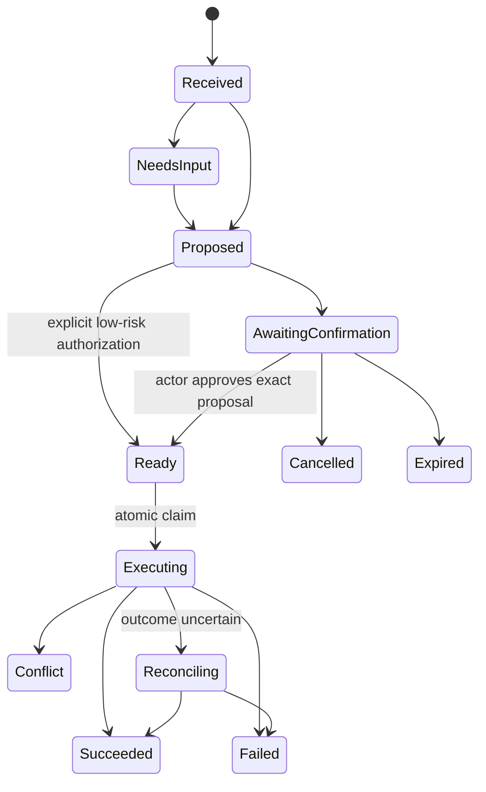

# Itinerary planning and application actions

Status: proposed. [Plan index](README.md). TripRaft AI performs authorized actions. Group Companion discusses and suggests only under the current design.

## Day planner

Collect destination(s), actual dates or number of days, local timezone, arrival/departure constraints, starting area, budget/currency, transport mode, pace and must-see places. Ask only for inputs necessary for a useful plan. Show assumptions for optional gaps, such as a moderate pace; never invent arrival times, confirmed reservations or accessibility guarantees.

```mermaid
flowchart LR
    I[Trip inputs and permitted preferences] --> C[Canonical candidate retrieval]
    C --> E[Evidence, hours, cost and location checks]
    E --> R[Geographic clustering and route estimates]
    R --> S[Deterministic schedule builder]
    S --> L[Optional model refinement and explanation]
    L --> V[Constraint validator and bounded repair]
    V --> D[Versioned draft, assumptions and unresolved items]
    D --> P[User selects Apply in TripRaft AI]
    P --> A[Authorized version-checked commit]
```

Retrieve approximately 30-60 candidates for a short trip, filter before prompting, and send a compact shortlist rather than the catalog. Use exact place identities and supporting facts. Rank by stated interests, feasible duration, proximity, evidence quality and budget. Respect exclusions, opening/access constraints and booking requirements. Apply diversity/fairness to permitted group preferences without exposing private reasons.

Cluster nearby visits into days. Use a bounded heuristic such as greedy insertion and local route improvement initially; compare against representative curated plans. Add a solver only when measured quality justifies it. For routing, use straight-line distance only to shortlist. A walk/drive/transit time requires a route provider or an explicitly labelled conservative estimate; a distance divided by speed does not establish a traversable route.

The deterministic validator checks:

- Local dates, timezone/DST offsets, arrival/departure windows and total day length.
- Visit durations, travel legs, transfer buffers, meal/rest breaks and fixed bookings.
- Regular hours, date exceptions, access events and last-entry times when supported.
- Budget scope, currency, visitor category and uncertainty ranges; no expense is created from a planned cost.
- Duplicate visits, distant detours, incompatible transport, accessibility requirements and user exclusions.
- Source freshness, missing coordinates/hours, and unsatisfied hard constraints.

Unknown opening hours produce a provisional visit with “verify hours,” never an invented open interval. Hard constraints must be satisfied for a plan to be marked feasible. If a requested itinerary is impossible, identify the conflict and offer feasible alternatives. One bounded model repair may resolve structure; deterministic checks run again. Preserve unresolved items instead of repeatedly calling models until the budget is exhausted.

Each draft includes `plan_id`, version, input assumptions, catalog/evidence versions, day schedules, route legs, estimated costs, booked/manual/locked items, citations and unresolved constraints. Render a timeline, map and compact overview. Provide expand-on-demand details; a long itinerary must use structured cards rather than a single truncated chat paragraph.

## Changes and replanning

“Make day two relaxed” or “Replace tomorrow's outdoor visits if it rains” creates a patch against a specific plan version. Preserve locked/booked/manual items unless explicitly selected for change. Recalculate only affected days and route boundaries. Explain the before/after diff and any budget or timing effect. A forecast-triggered suggestion is advisory; applying it requires TripRaft AI's action policy.

Use optimistic concurrency. If another member changed the itinerary, reload the current version and regenerate the diff. Never overwrite the latest plan with an older full document. An undo is a new authorized compensating action against current state, not a blind replay of the original snapshot.

## Capability registry

Every tool has a versioned schema, required application role, permitted assistant profiles, allowed data scope, audience classification, mutation/risk class, validation, idempotency rules and bounded result size. The following is a delivery sequence, not a statement that all tools already exist:

| Tool family | Initial operations | Authority |
|---|---|---|
| Public knowledge | Search/get places, weather, official travel requirements | Both assistants; no private context sent to research |
| Trip reads | List own groups, get itinerary and group-safe summary | App assistant; Companion can access selected group only |
| Ledger reads | Own expenses, selected shared ledger, balances, summaries | Domain permissions; personal results private |
| Planning | Draft itinerary, preview patch, explain alternatives | Both may draft; only app assistant may apply |
| Group actions | Create trip/group, update allowed settings, link existing expense group | App assistant; existing domain role checks |
| Expense actions | Create, edit, soft-delete, restore | App assistant; existing financial rules |
| Collaboration actions | Checklist/poll/place create/update/delete | App assistant; object-specific permissions |
| Invitations and roles | Prepare/send invite, change membership/roles | Later controlled capability; explicit recipient and stronger confirmation |
| Settlements | Suggest settlement, record explicitly requested settlement | Later capability; recording is not transferring funds |
| Export | Produce requested scoped report or plan | Private expiring download unless explicitly published |

No `execute_sql`, generic HTTP request, shell tool, arbitrary file read, or unrestricted “do task” function is exposed. Strict schemas improve argument structure but do not establish authorization or semantic correctness; the application validates both. [OpenAI function-calling specification](https://developers.openai.com/api/docs/guides/function-calling).

## Action policy

| Action | Required behavior |
|---|---|
| Read authorized records | Execute without confirmation; enforce scope and audience |
| Draft plan/report | Generate privately; persistence does not imply shared publication |
| Explicit, unambiguous low-risk creation | Execute once after validation and return receipt/undo where supported |
| Create expense from complete explicit command | May execute once if every money/member field is resolved; show actual split and receipt |
| Change amount, payer, split, membership, roles or group visibility | Show concrete diff and require explicit approval |
| Delete or bulk edit | Show selected records, count and effects; require approval |
| Invite/send/publish | Show destination, audience and content; require explicit send/publish authorization |
| Ambiguous instruction or target | Clarify; never select a financial/destructive target by fuzzy match alone |
| Unsupported permission | Deny clearly; never ask a model to work around it |

Do not add confirmation to every trivial action. A specific user command can already supply authorization for a reversible creation. Language in a web page, old chat message, tool result or quoted example is never an executable request. A confirmation must belong to the actor who initiated the proposal; someone else saying “yes” in group chat cannot approve it.

## Durable execution flow

Persist the proposal, normalized arguments, actor/scope, affected record versions, human-readable diff, expiry, schema/policy version and payload hash. Approval binds all of them. Any material change invalidates the approval. Start with a five-minute proposal expiry; keep the legacy 60-second confirmation endpoint separate until migrated.

At commit, reacquire the action, validate state/expiry and actor, recheck membership/role/consent where applicable, verify versions, and call the domain service. An approval never freezes permissions. Atomically transition the action state so concurrent confirmations cannot execute twice.

Use an idempotency key scoped to actor, profile, conversation turn and operation, with a normalized payload hash. A repeated key with a different payload returns a conflict. A repeated successful key returns the original receipt. Prevent ordinary double submissions with a unique conversation/client message ID as well. A timeout after commit triggers receipt lookup, not blind replay. A truly new deliberate duplicate expense can be created after displaying the recent possible duplicate.

The mutation and success receipt/outbox record must commit in one database transaction. Some current domain services own their transactions; refactor to accept a unit of work where needed before claiming this guarantee. Until then, disable automatic retries for those mutations and reconcile from a domain idempotency key. Existing Redis `GETDEL` confirms prevent a class of duplicate execution, but do not solve database commit uncertainty.

Notifications, realtime refresh and chat receipts are delivered by an outbox after commit with duplicate-safe consumers. A delivery failure does not roll back or repeat a financial mutation. A multi-domain workflow uses one transaction only where domains share a unit of work; otherwise show staged progress and use documented compensations. Never claim a partially completed workflow is fully done.

## Expense flow examples

**Create:** “Add EUR 120 dinner to the Rome trip, I paid, split equally between me, A and B.” Resolve the linked expense-group ID server-side, verify all three are active eligible members, validate money using the existing service, calculate shares and show the committed EUR 40 shares. Do not assume all group members were participants. Clarify if multiple Rome trips exist or member names collide.

**Edit:** “Change yesterday's taxi from 25 to 35.” Retrieve authorized candidates by group/date, let the user resolve ambiguity, preview old/new amounts and changed balances, then commit only against the selected expense version after approval.

**Delete:** “Delete dinner.” Show authorized candidate expenses with date, currency and amount; a description match alone is insufficient. Confirm one selected expense or an explicit list. Use existing soft-delete/history behavior and return a restore option when permitted.

**Read:** “How much do I owe?” Use ledger balances and active membership, with group and currency explicit. A private app-assistant answer may include authorized groups separately. Group Companion cannot disclose personal ledgers or silently combine currencies. Conversion summaries label estimates and rate time; historical recorded splits keep their original conversion basis.

All money uses `Decimal` or the existing validated minor-unit representation, currency-specific precision and deterministic remainder allocation. Validate multiple payers, shares, percentages and settlement effects in domain code. Models explain results; they do not calculate authoritative balances.

## Group creation and discussion flows

“Create a Kyoto trip for four days” resolves dates/timezone as needed, creates the requested group with the current user as owner, and returns a link. It does not invite contacts, make the group public, create expenses, or generate a paid booking implicitly. Expense-group linking is a separate authorized operation with both domains' access checks; trip IDs and expense-group IDs are not interchangeable.

In group chat, “What could we do on day two?” retrieves only that group's eligible context and public facts, then posts a read-only suggestion to the group. “Add this to the plan” produces a handoff to TripRaft AI under the current Companion scope. “Read everything and summarize” means authorized relevant group material, paginated with a stated date range and exclusions; it cannot override other members' consent or file permissions.

For mixed commands, return each step's status. Example: create a group successfully, then fail to link a ledger because access was revoked. Report both states and provide a safe next step. Do not automatically delete the successfully created group unless an authorized compensation was part of the reviewed workflow.
