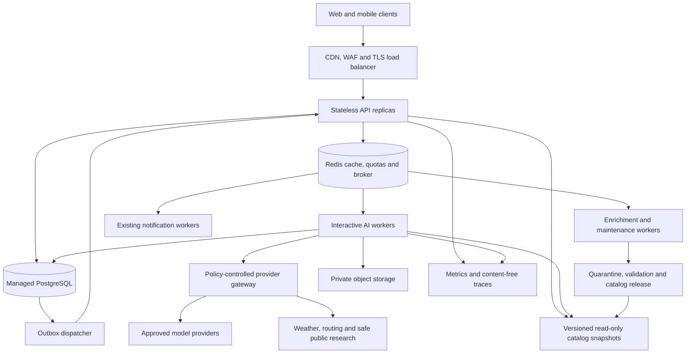

# Production infrastructure and operations

Status: proposed deployment design; capacity values are examples to validate. [Plan index](README.md).

## Initial production topology

Use a modular application with separately scalable worker pools. Managed PostgreSQL, Redis and object storage reduce operational load. Keep public catalog snapshots local to API/knowledge workers. Do not require Kubernetes, Kafka, service mesh or active-active regions to launch.

For a real production availability target, run at least two stateless API replicas across supported failure zones and use managed database backups/failover. Worker redundancy and provider capacity must be sized separately. Single-machine development remains supported. Inventory actual hosting region, data residency and integration requirements before choosing instance sizes.

Preserve Flask/realtime deployment compatibility: review the current Socket.IO transport and worker model before selecting HTTP workers and load-balancer affinity. Use a shared broker for cross-replica events and recipient authorization. Long model work must not block request workers or realtime heartbeats. Prefer existing realtime when it already meets needs; add SSE only for a concrete client requirement.

## Queue and scheduling policy

Define queues for interactive short answers, long planning/research, enrichment/evaluations, and existing notifications. Reserve interactive capacity. Separate budgets and concurrency so catalog refresh cannot starve a user expense operation or invitation email. Celery delivery is at least once; PostgreSQL request/action identity provides deduplication and recovery.

Set per-user and per-group limits, global provider concurrency, per-domain fetch limits and weighted fairness. Use admission control when queue age exceeds the response deadline. Return retry/pending state before work becomes useless. Expired queued work is discarded after checking whether any associated action already committed. A user cancelling a job frees unused reservations and prevents follow-on calls.

Do not keep money locks or database sessions open while waiting on providers. Fetch minimal context and its version, close the transaction, perform bounded reasoning/retrieval, then reauthorize/recheck versions for publication or commit.

## Capacity model

Use measured arrival rate and service time: average in-flight work is approximately `arrival rate * mean service time`. Size against peak and p95 distributions, then validate with load tests; averages alone hide queue collapse.

For illustration, 10 accepted messages/second with 20% requiring 15-second long work implies approximately 30 concurrent long jobs before headroom. It does not imply 30 CPUs: most work may be network waiting, while local inference has different GPU constraints. Check provider RPM/TPM, simultaneous streams, output tokens, weather quotas and page-fetch rate limits. A provider limit can be the bottleneck even with idle application workers.

Test 10, 50 and 100 simultaneous interactive sessions initially using realistic think time, route mix and ledger contention. These are test scenarios, not promised capacity. Produce an evidence report that identifies hardware, dataset, warm/cold cache, region, dependency mocks versus live calls, p50/p95/p99 latency, queue depth, timeout rate and actual token usage.

Scale worker pools by oldest queue age, arrival rate and measured processing time, bounded by provider quotas and spend. Scale API replicas by request latency/concurrency; scale catalog replicas by read throughput. Do not autoscale GPU inference without accounting for cold starts and minimum viable batch/latency behavior.

## Service objectives

Start with a 99.9% monthly availability objective for authenticated assistant submission/status and authorized deterministic paths, plus the latency targets in [cost and performance](cost-and-performance.md). Track externally grounded answer completion separately by provider and route. An HTTP 200 with an empty/unsupported answer is not a successful answered question.

Track these user outcomes: supported task completion, correct committed action, grounded answered question, clear abstention, useful partial answer and failure. Privacy/authorization violations and incorrect financial writes are release-blocking incidents, not errors to average into an availability percentage. Define an error budget for ordinary availability/latency and pause rollout when it is exceeded.

## Observability

Every request has a trace ID across gateway, tools, model adapter, worker, action and outbox. Record durations, queue age, profile, coarse intent, result class, dependency, model/prompt/policy version, evidence age, citation-validation result, quota reservation and actual billed usage. Use low-cardinality metric labels; never put user IDs, queries, expense text or URLs containing secrets into public metric labels.

Dashboards show p50/p95/p99 by route/profile, time to first validated content, complete-answer rate, abstention/unsupported-claim rate, action conflicts/duplicates, erasure backlog, cache hit/freshness, provider 429/5xx, pending outbox age, tokens and cost per successful task. Metadata traces are sufficient by default. Raw prompt capture must be exceptional, access-controlled, consented, redacted and short-lived.

Alert on unauthorized tool attempts, scope mismatch, attempted group publication of private material, duplicate financial side effects, stuck executing actions, spend spikes, old queues, unavailable providers, failed catalog deployment and erasure jobs beyond target. Keep a synthetic public-knowledge canary and synthetic financial workflow in an isolated test tenant; never mutate customer ledgers for monitoring.

## Resilience and recovery

| Failure | Expected behavior |
|---|---|
| Model unavailable | Deterministic answers and authorized app UI stay usable; no fake completion |
| Weather/research unavailable | Supported cached facts with age where permitted; otherwise unresolved current claim |
| Redis unavailable | Durable status/action state remains; pause unsafe admissions; no quota reset or in-memory confirmation fallback |
| Database unavailable | No writes; no private answer from stale unauthorized cache; public-only mode if separately isolated |
| Worker crash before commit | Redelivery can reclaim unstarted work with durable identity |
| Timeout after mutation commit | Reconcile receipt; never repeat the side effect blindly |
| Outbox/realtime failure | Mutation remains committed; retry delivery once per event identity |
| Catalog corruption/version mismatch | Reject bad release and serve last verified compatible snapshot |
| Membership/consent changes mid-request | Recheck and discard ineligible output; cancel related work |
| Regional incident | Execute tested failover plan under approved data-region policy |

Use circuit breakers and bounded retries with jitter for safe reads. Count retries against the same deadline and spend reservation. A model retry does not authorize re-running tool side effects. A provider fallback must satisfy the original privacy/region/capability policy.

Choose backup recovery objectives explicitly. Initial proposals: application data RPO at most 15 minutes and RTO at most 4 hours using verified managed capabilities; public catalog RPO one published version and RTO 1 hour. These require provider support and restore drills before being commitments. On restore, reapply revocations/deletion tombstones, reconcile executing actions and outbox receipts, and check schema/catalog compatibility before reopening writes.

## Environments and release

Keep development, staging and production credentials, databases, buckets, provider keys, budget accounts and catalog manifests separate. Use synthetic/redacted staging conversations and expense data. No production chat dumps in evaluation fixtures. Restrict egress, rotate secrets, use least-privilege runtime accounts and isolate ingestion privileges from assistant reads.

Version deployable code, tool schemas, prompt templates, model IDs, policy configuration, pricing tables and catalog manifests together in release metadata. Use feature flags for app answers, Companion, history, hosted private processing, itinerary apply, expense writes, invitations and public enrichment. Defaults fail closed for unconfigured dependencies.

Release with offline gates, staging workflows, staff/test tenants, 1% canary, then 10%, 50% and full rollout only as metrics permit. Roll back behavior via flags/config/code while leaving additive compatible schema in place. Do not reverse a migration destructively during incident response or reverse already committed user actions automatically. Production schema changes follow the existing administrator-approved release process.

## Growth triggers

| Add complexity only when | Candidate change |
|---|---|
| Semantic/multilingual retrieval misses remain after aliases/FTS improvements | Embedding index with measured retrieval gain |
| Catalog SQL/read replicas cannot meet load or update needs | Dedicated knowledge service or PostgreSQL/PostGIS serving projection |
| Multiple independent consumers require retained replay beyond the outbox | Event bus with clear partition/deduplication semantics |
| Deployment count/team boundaries need stronger isolation | Independently deployable provider/action/knowledge services |
| Sustained local inference wins equivalent quality/latency economics | Managed GPU pool with queueing and redundancy |
| Region/residency and latency demand justify duplicate operations | Regional read/model processing with explicit data boundaries |

At each trigger, record the measured bottleneck, alternative, expected benefit and ongoing operations cost. The durable permissions, evidence and action contracts should survive these topology changes.
