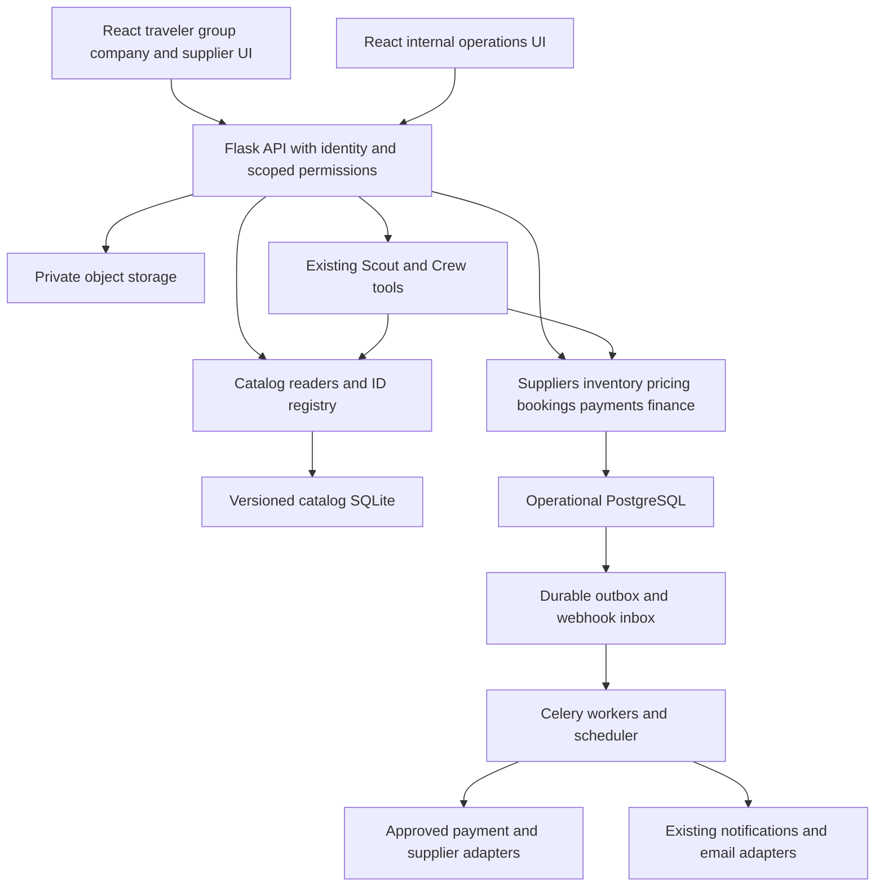

# TripRaft architecture and proposed file structure

This is a target file map. New source files and folders below are proposals to create during their phase, not files already implemented by this planning task. Existing files marked `extend` retain their paths and responsibilities. Avoid empty scaffolding for phases that have not started.

## System structure



Redis supplies cache, rate limits and Celery transport. PostgreSQL holds durable financial actions, event receipts and inventory. Redis loss must not permit duplicate money movement or create seats. Inventory writes and ledger postings share the operational database but use separate domain services.

## Monorepo target

```text
C:/Tripraft/
  apps/
    web/                                      extend traveler and supplier app
      src/
        App.jsx                               extend current route composition
        app/                                  phase 1; extract incrementally
          router.tsx
          providers.tsx
          layouts/
            PublicLayout.tsx
            WorkspaceLayout.tsx
            PartnerLayout.tsx
        features/
          auth/                               extend session and MFA UI
          discover/                           extend existing place discovery
          trips/                              extend planner; add booking linkage
          itinerary/                          extend existing itinerary
          expenses/                           extend existing expense UI only
          polls/                              existing
          scout/                              extend existing consent and tools UI
          workspaces/                         phase 1
            WorkspaceSwitcher.tsx
            WorkspaceProvider.tsx
            workspaceApi.ts
            workspaceKeys.ts
            permissions.ts
          marketplace/                        phase 3
            pages/
              OfferSearchPage.tsx
              OfferDetailPage.tsx
            components/
              OfferCard.tsx
              DeparturePicker.tsx
              AvailabilityLabel.tsx
              SellerDisclosure.tsx
            marketplaceApi.ts
            marketplaceKeys.ts
          agency/                             phase 2 onward; supplier workspace
            pages/
              PartnerOverviewPage.tsx
              OnboardingPage.tsx
              ContractsPage.tsx
              ProductsPage.tsx
              OfferEditorPage.tsx
              DeparturesPage.tsx
              BookingQueuePage.tsx
              ManifestPage.tsx
              PayoutsPage.tsx
              PartnerTeamPage.tsx
            components/
              ContractSummary.tsx
              DepartureCalendar.tsx
              InventoryChangePreview.tsx
              BookingAcceptancePanel.tsx
            agencyApi.ts
            agencyKeys.ts
          commerce/                           phases 4 through 7
            pages/
              CheckoutPage.tsx
              PaymentResultPage.tsx
              PaymentMethodsPage.tsx           phase 9
            components/
              PriceBreakdown.tsx
              QuoteExpiry.tsx
              TravelerForm.tsx
              HostedPaymentButton.tsx
              CancellationTerms.tsx
            commerceApi.ts
            commerceKeys.ts
            checkoutReducer.ts
          bookings/                           phase 4 onward
            pages/
              MyBookingsPage.tsx
              BookingDetailPage.tsx
              CancellationRequestPage.tsx
            components/
              BookingTimeline.tsx
              BookingDocuments.tsx
              TripBookingCard.tsx
            bookingsApi.ts
            bookingsKeys.ts
          organizations/                      phase 10
            OrganizationMembersPage.tsx
            CostCentersPage.tsx
          approvals/                          phase 10
            ApprovalQueuePage.tsx
            ApprovalDetailPage.tsx
          corporate/                          phase 10
            TravelRequestPage.tsx
            PolicySettingsPage.tsx
            BudgetReportPage.tsx
        lib/
          commerceMoney.ts                     new exact display/validation helpers
          queryKeys.ts                         new scoped key conventions
        __tests__/                            extend existing regression suites
        features/<new-feature>/__tests__/      new focused component/contract tests
      tests/                                  existing Jest transforms
      tsconfig.json                           extend TS/TSX inclusion
      babel.config.cjs                        extend typed-test transpilation
      package.json                            extend api-client/test dependencies
    admin/                                    extend internal operations
      src/
        App.tsx                               preserve account initialization
        app/
          router.tsx
          AdminLayout.tsx
        features/
          suppliers/
            SupplierReviewPage.tsx
            ContractReviewPage.tsx
          offers/
            OfferReviewPage.tsx
            PricingReviewPage.tsx
          bookings/
            BookingOperationsPage.tsx
          finance/
            PaymentsPage.tsx
            RefundApprovalPage.tsx
            PayoutApprovalPage.tsx
            ReconciliationPage.tsx
            LedgerTracePage.tsx
            ContributionPage.tsx
          support/
            SupportCasesPage.tsx
          audit/
            CommerceAuditPage.tsx
        lib/
          adminApi.ts
          adminPermissions.ts
  services/
    api/
      app/
        auth/                                 extend existing users/auth; no second user model
        trips/                                extend existing TravelGroup/membership
        itinerary/                            extend current trip/catalog integration
        expenses/                             preserve traveler finance domain
        places/                               extend catalog facade
          catalog_registry.py
          catalog_references.py
        scout/                                extend current AI services
          tools/
            marketplace_tools.py
            booking_proposal_tools.py
            authorization.py
        notifications/                        extend existing delivery
          services/
            commerce_notifications.py
        workspaces/                           phase 1
          __init__.py
          models.py
          permissions.py
          context.py
          schemas.py
          routes.py
          services/
            workspace_service.py
            legacy_ownership_service.py
        suppliers/                            phase 2
          __init__.py
          models.py
          schemas.py
          permissions.py
          routes/
            __init__.py
            onboarding.py
            contracts.py
            team.py
            admin_review.py
          services/
            onboarding_service.py
            contract_service.py
            verification_service.py
        marketplace/                          phase 3; content and contractual offers
          __init__.py
          models.py
          schemas.py
          routes/
            __init__.py
            public_offers.py
            partner_products.py
            partner_offers.py
            admin_review.py
          services/
            product_service.py
            offer_service.py
            publication_service.py
        inventory/                            phases 3 and 4
          __init__.py
          models.py
          schemas.py
          routes.py
          services/
            departure_service.py
            availability_service.py
            hold_service.py
            inventory_reconciliation.py
          adapters/
            base.py                           capability-based supplier interface
            allocated.py
            manual.py
            external_provider.py              phase 9; first approved provider only
        pricing/                              phase 4
          __init__.py
          models.py
          schemas.py
          routes.py
          services/
            quote_service.py
            tax_service.py
            discount_service.py
            contribution_service.py
            dynamic_rules.py                  phase 9
        bookings/                             phase 4 onward
          __init__.py
          models.py
          schemas.py
          permissions.py
          state_machine.py
          routes/
            __init__.py
            customer_bookings.py
            partner_bookings.py
            booking_documents.py
          services/
            booking_service.py
            supplier_reservation_service.py
            confirmation_service.py
            cancellation_service.py
            trip_link_service.py
            fulfillment_service.py
        payments/                             phase 5
          __init__.py
          models.py
          schemas.py
          routes/
            __init__.py
            orders.py
            webhooks.py
            payment_methods.py                phase 9
          services/
            order_service.py
            capture_service.py
            webhook_service.py
            refund_service.py
          providers/
            base.py                           capability matrix and interface
            fake.py                           deterministic sandbox testing
            razorpay.py                       OR cashfree.py after selection
        finance/                              ledger foundation phase 5; full phase 7
          __init__.py
          models.py
          schemas.py
          permissions.py
          routes/
            __init__.py
            invoices.py
            supplier_payouts.py
            reconciliation.py
            admin_finance.py
          services/
            journal_service.py
            posting_templates.py
            payable_service.py
            payout_service.py
            invoice_service.py
            credit_note_service.py
            reconciliation_service.py
            contribution_reporting.py
        support/                              phase 6
          __init__.py
          models.py
          routes.py
          services.py
        organizations/                        phase 10
          __init__.py
          models.py
          schemas.py
          routes.py
          services.py
        approvals/                            phase 10
          __init__.py
          models.py
          policy.py
          routes.py
          services.py
        core/                                 extend existing shared infrastructure
          factory.py                          register new blueprints explicitly
          config.py                           typed/validated commerce settings
          security.py                         precise webhook authentication path
          idempotency.py                      preserve legacy compatibility
          money.py                            new minor-unit/Decimal primitives
          storage.py                          new private object storage abstraction
          commerce_idempotency.py              new durable mutation registry
          commerce_audit.py                    new redaction and audit interface
          events/
            __init__.py
            models.py                         transactional outbox/inbox metadata
            outbox.py
            dispatcher.py
          db/
            base.py                           existing shared metadata
            connection.py                     extend explicit model imports
          workers/
            celery_app.py                     extend task include list
            schedules.py                      extend beat schedule
            tasks/
              inventory_tasks.py
              payment_tasks.py
              finance_tasks.py
              commerce_event_tasks.py
              supplier_sync_tasks.py          phase 9
      migrations/
        env.py                                extend model imports
        versions/                             actual Alembic IDs assigned at build time
          <revision>_workspace_ownership.py
          <revision>_supplier_contracts.py
          <revision>_products_offers_departures.py
          <revision>_quotes_holds_bookings.py
          <revision>_payments_events_ledger.py
          <revision>_invoices_refunds_payouts.py
          <revision>_corporate_approvals.py
      contracts/
        commerce/                             explicit schemas/examples; exporter consumes
          offers.json
          checkout.json
          bookings.json
          payments.json
          finance.json
      tests/
        commerce/                             pure/service and integration contracts
          test_money_and_tax.py
          test_workspace_access.py
          test_supplier_contracts.py
          test_offer_publication.py
          test_quotes.py
          test_booking_transitions.py
          test_webhook_security.py
          test_ledger_postings.py
          test_refunds.py
          test_supplier_payouts.py
          test_openapi_contracts.py
        postgres/                             independent PG harness; no SQLite conftest override
          conftest.py
          test_hold_contention.py
          test_hold_expiry_capture_race.py
          test_durable_idempotency.py
          test_event_recovery.py
          test_ledger_constraints.py
          test_commerce_migrations.py
  packages/
    api-client/
      src/
        index.ts                              extend shared typed client exports
        generated/schema.d.ts                 regenerate; never hand edit
    types/
      src/
        index.ts                              retain legacy Money compatibility
        commerce.ts                           new exact minor-unit contracts
        permissions.ts
    ui/
      src/
        commerce/
          MoneyDisplay.tsx
          StatusLabel.tsx
          AccessibleDialog.tsx
  data/
    catalog/                                  preserve source SQLite and provenance
    runtime/                                  ignored local operational data
    seeds/
      commerce/                               synthetic fixtures only
  infra/
    docker/
      docker-compose.yml                      extend worker/scheduler readiness
      .env.example                            document nonsecret settings
    github/workflows/
      ci.yml                                  canonical workflow; add commerce PG job
      deploy.yml                              canonical staged release gates
    tools/
      export_openapi.py                       extend explicit commerce schema coverage
      catalog_inventory.py                    proposed read-only inventory report
      backfill_workspace_ownership.py          proposed restartable migration command
      commerce_reconcile.py                    proposed audited operations command
    terraform/                                provider-specific provisioning after decision
  tests/e2e/                                  proposed browser suite, added with runner config
    traveler-checkout.spec.ts
    supplier-confirmation.spec.ts
    refunds-and-finance.spec.ts
    tenant-isolation.spec.ts
  docs/
    plans/unified-marketplace-reseller/        this implementation package
    decisions/                                approved technical/commercial decision summaries
    runbooks/commerce/                         phase-specific operator procedures
```

Naming rule: backend modules are business domains; routes validate HTTP/authentication, services control transactions, models enforce persistence constraints, and adapters implement provider behavior. Keep provider-specific statuses and payloads inside adapters. Add each new Python package to explicit imports and each background task to worker discovery.

## Domain responsibilities

| Domain | Owns | May call |
| --- | --- | --- |
| Workspaces | Membership, active actor context, capability checks, legacy ownership bridge | Existing auth and trip membership adapters |
| Suppliers | KYB status, supplier staff, versioned contracts, beneficiary references | Approved verification provider adapter |
| Marketplace | Products, offer publication, seller identity, content licenses | Suppliers, catalog facade, pricing approval checks |
| Inventory | Departures, sellable allotment, active holds, reservations, inventory events | Supplier adapters |
| Pricing | Versioned rates/tax/promotions, immutable quote, contribution estimate | Contracts, inventory reads, approved tax configuration |
| Bookings | Traveler and payer links, reservation orchestration, confirmation and fulfillment | Inventory, pricing, payments status, notifications, finance |
| Payments | Provider orders/capture facts, webhook ingress, refund execution | Provider adapters, durable inbox, finance posting interface |
| Finance | Balanced journals, payables, invoices, payouts, reconciliation and exceptions | Payment provider adapter, contract snapshots |
| Support | Cases, supplier failures, disruption and resolution tracking | Booking/refund APIs subject to operator permissions |
| Scout/Crew | Authorized research and proposals | Typed domain APIs; no direct commerce table writes |

Avoid transactions hidden inside each subservice. A coordinating booking/finance service supplies one SQLAlchemy session for atomic internal mutations. External API calls use persisted operation intents and happen outside locked inventory transactions.

## Frontend routes

| Surface | Proposed paths | Access |
| --- | --- | --- |
| Public offers | `/packages`, `/packages/:offerId` | Reviewed public projection only |
| Checkout | `/checkout/:bookingId`, `/checkout/:bookingId/result` | Booker/payer with server authorization |
| Traveler bookings | `/bookings`, `/bookings/:bookingId`, `/bookings/:bookingId/cancel` | Buyer or explicitly authorized collaborator |
| Group planner | Existing `/group-planner/:groupId` with booking panel | Existing trip access plus per-booking visibility |
| Supplier portal | `/partner/:workspaceId/*` | Supplier membership and action capability |
| Company travel | `/workspaces/:workspaceId/travel/*` | Organization role, policy and approval capability |
| Internal admin app | `/suppliers`, `/offers`, `/bookings`, `/finance/*`, `/support` | Granular platform permission and required MFA |

Keep current public/auth/trip/expense routes working. A route guard improves navigation; backend query scope is the authorization boundary. Supplier owners cannot self-approve supplier verification, bank changes or publication.

## Existing files requiring deliberate changes

| Existing file | Required change and reason |
| --- | --- |
| `services/api/app/core/factory.py` | Register required commerce routes; fail closed for missing required components |
| `services/api/app/core/db/connection.py` | Import new domain models in `_import_all_models`; commerce uses primary DB, never travel replica routing |
| `services/api/migrations/env.py` | Include new models in the existing `Base.metadata`; avoid a second unconnected migration history |
| `services/api/app/core/config.py` | Validate environment, enabled sale models, provider, supported currencies, timeouts and storage |
| `services/api/app/core/security.py` | Exempt only exact signed provider webhook routes from browser CSRF; raw-body verification replaces cookie authentication there |
| `services/api/app/core/idempotency.py` | Bypass its optional Redis replay behavior on routes using durable commerce idempotency; prevent conflicting replay semantics |
| `services/api/app/core/workers/celery_app.py` | Discover commerce tasks and initialize the same app/config/model context in workers |
| `services/api/app/core/workers/schedules.py` | Add expiry, inbox/outbox recovery, payment rechecks, payouts and reconciliation schedules |
| `services/api/tests/conftest.py` | Preserve safe SQLite legacy defaults; explicitly permit isolated PostgreSQL test mode before any `app` import, or use a sibling test root outside this conftest |
| `apps/web/src/App.jsx` | Compose new lazy routes while preserving auth and current planner behavior |
| `apps/web/tsconfig.json`, Babel/Jest/ESLint config | Check every new TS/TSX file and run typed component tests; existing entry-only checking is insufficient |
| `apps/web/package.json` | Add workspace api-client/types dependencies and test tooling needed by new features |
| `apps/admin/src/App.tsx` | Extract console sections into routes; preserve account initialization and server checks |
| `packages/types/src/index.ts` | Add new exports; do not silently redefine legacy `Money = number` |
| `infra/tools/export_openapi.py` | Attach real request/response/error definitions to every new operation |
| `infra/docker/docker-compose.yml` | Run required commerce workers and one scheduler; mount catalog/storage only where needed |
| `infra/github/workflows/ci.yml` | Run fresh migration, upgrade and contention checks on isolated PostgreSQL |
| `infra/github/workflows/deploy.yml` | Staging smoke tests, migrations, secrets and explicit live-money release gates |
| `infra/tools/document_files.py`, `docs/files.md` | Refresh the file-purpose guide when source files are actually introduced |

Use `pnpm workflows:sync` after editing canonical workflows. Keep `.github/workflows` synchronized rather than editing a second independent copy. Update launcher behavior only when commerce becomes an enabled local capability; ordinary planner-only development can continue using SQLite.

## Cache and privacy boundaries

New query keys include actor, workspace, resource and projection: `['commerce', actorId, workspaceId, 'booking', bookingId, 'buyer']`. Invalidate on workspace/identity changes. Do not persist checkout secrets, passenger documents, payment tokens, private net rates or finance responses in the existing IndexedDB query persistence. Explicitly allowlist safe cache data.

Use separate public, buyer, trip-summary, supplier-fulfillment and finance serializers. Do not serialize an ORM model and hide fields afterward in React. Store files privately with document purpose, owner and per-object grants. Signed URL issuance requires fresh permission checks; object keys alone do not grant access.
