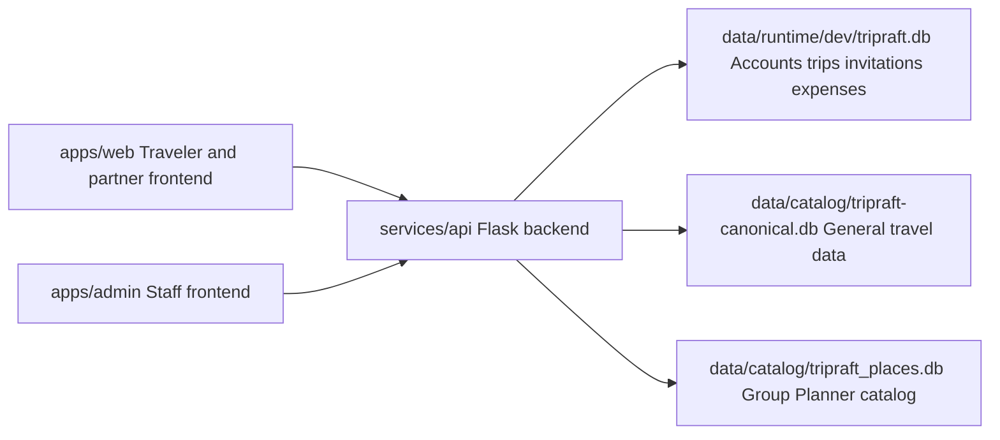

# TripRaft folders and databases

TripRaft has two React frontends and one Flask backend. Browsers call the backend
API; the backend reads and writes the appropriate database. A browser does not
open a SQLite file directly. Sharing code through GitHub does not share live data.



## Main folders

| Folder or file | Purpose | How to maintain it |
| --- | --- | --- |
| `apps/web/` | Traveler site, trip planner, expenses and partner portal | Edit frontend features here |
| `apps/admin/` | Separate staff review console | Edit staff screens here |
| `services/api/app/` | Flask API, authentication, business rules and database access | Edit backend behavior here |
| `services/api/migrations/` | Alembic application database migrations | Change operational schema through migrations |
| `services/api/schema/` | SQL definitions for reference catalogs | Preserve schema compatibility when importing travel data |
| `services/api/tests/` | Backend regression tests | Run tests relevant to backend changes |
| `services/api/uploads/` | Runtime uploaded files | Local data; durable storage is needed when hosted |
| `packages/` | Shared UI, API client, types and developer configuration | Keep shared contracts consistent |
| `data/catalog/` | Active reference databases and exported catalog documentation | Preserve database IDs and source provenance |
| `data/runtime/` | Local application data | Never commit it or replace it with a catalog |
| `data/archive/` | Preserved inactive database copies | Retain until a separate data-retention decision |
| `data/seeds/` | Seed input documentation | Startup does not automatically import seed data |
| `docs/` | Architecture, operating guides, plans and reports | Put documentation here |
| `docs/plans/` | Implementation plans and planning-document index | Keep future work separate from completed behavior |
| `docs/plans/source-documents/` | Original Word/PDF planning documents moved from the root | Four previously versioned specifications remain versioned; the previously untracked beta original stays local |
| `docs/plans/local-archive/` | Older local roadmap | Local and ignored |
| `docs/extra/` | Archived document extraction and page images | Local and ignored except its index |
| `docs/reports/` | Dated audits, verification and move records | Reports describe the state when written |
| `docs/interactive/` | Optional local setup checklist | This is separate from Sapling Smartlog |
| `infra/docker/` | Local Docker topology | Runs PostgreSQL, Redis and the API |
| `infra/remote-beta/` | Shared beta image, Render Blueprint and configuration wizard | Set cloud credentials in Render Environment |
| `infra/tools/` and `infra/tests/` | Source checks, utilities and launcher tests | Keep operational tools out of planning folders |
| `infra/github/workflows/` | Canonical GitHub workflows | Synchronize their `.github/workflows/` discovery copies |
| `infra/terraform/` | Provisioning scaffolding | No cloud infrastructure is created by moving files |
| `script/` | Local data enrichment pipeline and its own datasets/dashboard | Preserve working paths; it is not the app backend |
| `sql_database/` | Local SQL import inputs and geography importer | Preserve importer paths and source data |
| `wikidata/` | Local country enrichment tool and source snapshots | Preserve tool-relative paths |
| `extra/` | Earlier code/history archives, cached tools and local environments | Keep archives and executable dependencies distinct from docs |
| `.tripraft/` | Launcher state, logs, backups and local tools | Generated/local and ignored |
| `.git/` | Git and Sapling repository metadata | Keep in place |
| `.github/` | GitHub-discovered CI workflows | Keep in place |
| `.venv/`, `node_modules/`, `.pnpm-store/` | Installed development dependencies | Generated/local; not documentation |
| `.turbo/`, `.pytest_cache/`, `.ruff_cache/`, `__pycache__/` | Build, test and Python caches | Generated/local and ignored |
| `start.py` | Local setup/start/stop launcher | Run from the repository root |
| Root `package.json`, pnpm and Turbo files | Workspace dependency and task definitions | Required in the root |

## Which databases the app currently uses

The following is the inspected configuration on October 19, 2026. Environment
overrides can change it; check the backend settings before moving any database.

| Database | Contents or role | Backend setting |
| --- | --- | --- |
| `data/runtime/dev/tripraft.db` | Active local users, groups, invitations, trips, expenses and partner records; Alembic-managed | `DATABASE_URL` in `services/api/.env` |
| `data/catalog/tripraft-canonical.db` | Schema-valid general travel catalog; currently no countries, states, cities or places | `TRAVEL_DATABASE_PATH`; ORM travel reads default to this through `TRAVEL_DATA_URL` |
| `data/catalog/tripraft_places.db` | Populated Group Planner catalog: 191 countries, 1,790 states, 6,478 cities and 30,339 places | `GROUP_PLANNER_CATALOG_PATH` |
| `data/runtime/tripraft.db` | Older application database, not selected by the current development `.env`; no Alembic revision was recorded | Fallback when running the API without the launcher's configured development database |
| `data/archive/root-tripraft-2026-10-19.db` | Former root `tripraft.db`; empty travel-schema database, not the configured application database | Not referenced by active runtime configuration |

The canonical catalog and Group Planner catalog are different files with different
roles. An empty canonical catalog does not mean the populated planner data is
missing. Do not replace the operational database with either catalog.

The enrichment pipeline also has databases under `script/data/catalog/`, including
`tripraft_places.enriched.db`, `tripraft_places.table_enriched_v2.db`, a backup and
checkpoint state. These contain separate processing results; they are not selected
by the current app configuration. They were preserved. Compare fields, provenance,
IDs and schema compatibility before promoting an enriched dataset into the app.

SQLite `-wal` and `-shm` files are live journal/coordination files, not independent
databases or spare documents. They were removed from Git tracking, not deleted
from disk. Do not manually move or delete them while a process is using the database.

The two reference catalog `.db` files are currently versioned for cloning and the
beta image build. Operational databases, archived copies, enrichment workspaces,
credentials, upload files and SQLite journals stay local.

## How frontend backend and database connect

Local development uses these settings:

```dotenv
# apps/web/.env.local and apps/admin/.env.local
VITE_API_BASE_URL=/api

# services/api/.env -- existing local configuration; examples only
DATABASE_URL=sqlite:///C:/Tripraft/data/runtime/dev/tripraft.db
TRAVEL_DATABASE_DIR=C:/Tripraft/data/catalog
# Defaults resolve these paths without extra variables:
# TRAVEL_DATABASE_PATH=C:/Tripraft/data/catalog/tripraft-canonical.db
# GROUP_PLANNER_CATALOG_PATH=C:/Tripraft/data/catalog/tripraft_places.db
```

The web frontend runs on port 5173 and the staff frontend on 5174. Their Vite
development proxies forward `/api` to Flask on port 5000. The backend's
SQLAlchemy connection uses `DATABASE_URL` for operational data. General travel
readers use the canonical catalog, while the planner's catalog reader opens the
populated planner file read-only.

Run `python start.py` from the root to start the local apps. After changing an
environment setting, restart through the launcher. Do not move database files to
`docs/` or put database credentials in frontend settings.

## Shared beta between India and the USA

Use one public website/API and one hosted operational PostgreSQL database.
`DATABASE_URL` on Render points to Supabase; the beta image keeps the travel
reference catalogs separate. Both developers use the same public beta URL and
fresh beta accounts. Each laptop can still have an independent local development
database. Cloning the same repository and copying `.env` does not synchronize it.

See [remote beta setup](remote-beta-setup.md), [Gmail sender setup](gmail-beta-email.md)
and [shared code in Sapling](team-code-workflow.md). Cloud accounts and credentials
are still required before the shared beta can be deployed and tested.

## This organization pass

Five original root Word/PDF documents were relocated under
`docs/plans/source-documents/`, preserving their prior versioned/local status.
The old roadmap moved to
`docs/plans/local-archive/`, and extracted blueprint text/page images moved to
`docs/extra/blueprint-review/`. Document-processing libraries stayed in
`extra/blueprint-review/tools/`. The unused root database was archived under
`data/archive/`. All moved file contents were preserved and verified by SHA-256.
No database records were merged, imported or deleted. Active database, importer,
enrichment, dependency and source-code paths stayed in place.
